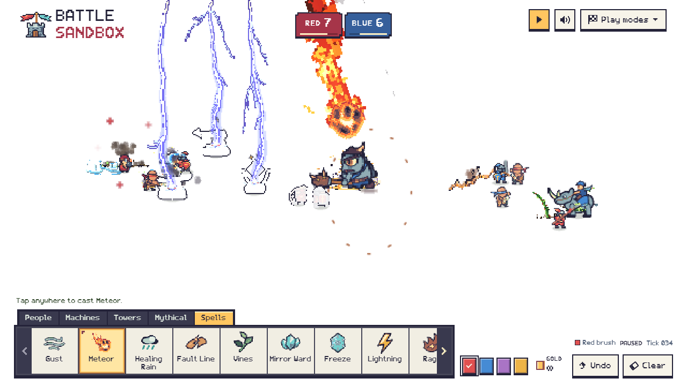

# Battle Sandbox

Paint troops onto a shared field and watch them fight, alone in the playground or against one to three other players. The project's own work is underneath the field: a deterministic combat engine, and a match server that charges each purchase once even when a reply is lost, a player reconnects or the server crashes mid-save.

[Play online](https://bob-zhu3.github.io/battle-sandbox/) · [How to play](docs/gameplay.md) · [Live demo guide](docs/defense.md)

Run `npm run demo:spells` for a paused volley of lightning, a falling meteor, and a fault opening beneath the front line. Press Space to see the impacts and their fading marks, then choose a spell to cast it yourself.

Run `npm run demo:pixels` to open a 32-troop skirmish just before a meteor lands. The pixel artwork runs in the playground, duels and free-for-all matches. To watch a Rhino Rider build up speed and scatter a front rank, open the [charge demo](https://bob-zhu3.github.io/battle-sandbox/?demo=rhino) and press Play.



## Starting point and contributions

- **Starting point.** An empty TypeScript canvas project, tagged [`project-start`](https://github.com/Bob-Zhu3/battle-sandbox/tree/project-start) at commit `6019281`. Everything after the tag is project work: [all changes since the start](https://github.com/Bob-Zhu3/battle-sandbox/compare/project-start...main).
- **Change from the proposal.** This game replaces the agent-delivery simulator in the proposal. A live match puts concurrent purchases, reconnects and a server crash on screen in two browser windows at once.
- **Team and contributions.** Bob Zhu and Cunzhou Ran shared the game design and the work of deciding how multiplayer should behave when something goes wrong. Bob specified troop interactions and the expected results of the two server crashes. Cunzhou helped design how matches should handle failures and proposed cases to test that behavior. OpenAI Codex implemented the game, tests and demo scripts, ran the checks and helped prepare the writeup. The [commit history](https://github.com/Bob-Zhu3/battle-sandbox/commits/main) records the changes.
- **Reused.** Vite bundles the game, `ws` carries local WebSocket traffic, `sirv` serves the production build, Playwright drives the browser checks, and Node's built-in SQLite backs the local crash check and the hosted-match tests. The [animation credits](third_party/pixelfx/README.md) and [sound credits](src/audio/SOURCES.md) list the sources used. GitHub Pages hosts the public game. The [hosted match service](.openai/hosting.json) keeps matches in a D1 SQLite database.

## Components

Three parts hold the project's own decisions. Each has checks whose expected results are worked out by hand.

| Component | What it decides | Main files | Checked by |
| --- | --- | --- | --- |
| Combat engine | Movement, targeting and damage on a fixed 60-tick clock. Distance ties break by stable ID and all damage on a tick lands together, so the same placements always produce the same battle. | [src/simulation.ts](src/simulation.ts), [src/units.ts](src/units.ts) | [tests/duel.test.mjs](tests/duel.test.mjs): two 40 HP Warriors in reach trade 10-damage hits on ticks 1, 31, 61 and 91 and fall on the same tick. |
| Match server | Territory and gold checks, troop IDs, seats held for 60 seconds after a disconnect, and purchase receipts. The hosted service saves the world, seats and receipts in one version-checked write. | [server/room.ts](server/room.ts), [server/online-match.ts](server/online-match.ts), [server/match-database.ts](server/match-database.ts), [server/socket.ts](server/socket.ts) | `npm run demo:crash`, [tests/online-match.test.mjs](tests/online-match.test.mjs), [tests/room.test.mjs](tests/room.test.mjs) |
| Reconnecting client | Saves each purchase in browser storage before sending it, resends unconfirmed purchases after reconnecting, reclaims the seat with its token, and switches from WebSockets to HTTPS when the hosted socket doesn't open. | [src/room-connection.ts](src/room-connection.ts), [src/online-wire.ts](src/online-wire.ts) | `npm run demo:retry`, `npm run demo:reconnect`, `npm run check:invites` |

The 44 troops and buildings, 10 spells, artwork and sound are game content built on the engine, not separate components. [docs/gameplay.md](docs/gameplay.md) describes them.

## Run it

Use Node.js 22.18 or newer. From a fresh clone:

```sh
npm ci
npm run play
```

The playground opens in your browser. Choose **Play modes** for a duel or a free-for-all. To host on your Wi-Fi, open the **Network URL** printed in the terminal before choosing a mode, then use **Copy invite** to share that match. For two seats on one computer, open the invite in a second browser.

`npm run dev` serves the game on loopback only. To serve the production build, run `npm run build` and `npm start`. The Node server defaults to `127.0.0.1:4173` and accepts `HOST` and `PORT`.

## Checks

Expected values are worked out by hand rather than read back from the code under test. For example, five Warriors at 12 gold each leave Red 60 of its 120 gold, and two 40 HP Warriors trading 10-damage hits both fall on the fourth exchange.

| Command | What it demonstrates |
| --- | --- |
| `npm test` | Fixed-tick combat, troop interactions, towers, spells, returning to a full-roster fight, brush spacing, spending and two real WebSocket clients |
| `npm run typecheck` | Strict TypeScript across the game and the server |
| `npm run demo:crash` | Kill and restart the server at both sides of a purchase save and verify both windows and the recovered database |
| `npm run demo:retry` | Drop confirmation of a five-Warrior stroke, disconnect and return with the original five IDs and one charge |
| `npm run demo:reconnect` | Disconnect Blue after the first hit, catch up to the live fight and verify both browsers agree through the fall of a base |
| `npm run demo:room -- --headed` | Two browser windows drawing at the same time, then recruiting during a base battle |
| `npm run check:invites` | Create two independent duels, share an invite between desktop and phone-sized browsers, reconnect during combat, and start a three-player free-for-all. Pass a running site's URL to exercise the deployed game, and add `--http --duel-only` to exercise the HTTPS fallback. |
| `npm run check:modes` | All 54 portraits, touch scrolling, recorded battle voices, live spell purchases, desktop and phone reconnects after a spell or reflected bolt, and complete three- and four-player matches with rematches |
| `npm run bench:crowd` | Repeat the same 80- and 200-troop fights, report browser frame intervals and simulation times, and fail if the world at tick 152 differs from the reference |

Browser checks use Playwright Chromium when available or installed Chrome. Use `npx playwright install chromium` to install the test browser. The two disconnect demos leave their result windows open until you close one. Add `-- --headless` for unattended use or `-- --output <directory>` to save both views and the comparison.

Pushing to `main` runs `npm test`, then `npm run build:pages`, which type-checks before building, and publishes the game to GitHub Pages. To check a release, run `npm run check:invites -- https://bob-zhu3.github.io/battle-sandbox/`.

## Demonstrate a server crash

Run `npm run demo:crash` from this directory. It opens Red and Blue in two browser windows. Each case starts a fresh match with 120 gold and has Red draw five Warriors at 12 gold each. The controller kills the local server process, starts a new one on the same database, reads the recovered state, then lets Red's automatic retry reach the server.

| When the process dies | On disk at restart | After the same command arrives again |
| --- | --- | --- |
| Immediately before the save | No Warriors, 120 gold, no receipt | Warriors 1–5, 60 gold, one receipt |
| After the save and before replying | Warriors 1–5, 60 gold, one receipt | Warriors 1–5, 60 gold, one receipt |

The match server saves the troops, balance, and receipt in one version-checked SQLite write. The receipt is scoped to the player, round, and command ID. A retry can therefore finish an interrupted purchase or return the IDs assigned by the first attempt. The check inspects the new process's database, observes the buyer retransmit the identical command, and reads the ID labels actually painted in both windows. It runs the hosted server's HTTP handler against a local SQLite file. Use `npm run demo:crash -- --headless` for an unattended check.

As a control, we temporarily disabled the receipt lookup in a separate checkout. The crash before the save still passed. After the save, the demo caught ten Warriors and zero gold on disk. Restoring the lookup returns five Warriors and 60 gold in both cases.

## Design decisions

### 1. Save each purchase's receipt in the same write as the world

- **Choice.** Each purchase carries its round and a command ID. The server stores its reply, the receipt, together with the troops and gold the purchase changed, in one version-checked write. A repeated command gets the stored reply instead of buying again.
- **Alternative.** Resend unconfirmed purchases without receipts. A crash after the save but before the reply then buys the squad twice. The control run above measured exactly that: ten Warriors and zero gold.
- **Commits.** Receipts in the room server: [ac05092](https://github.com/Bob-Zhu3/battle-sandbox/commit/ac05092). Saved with the hosted match: [bf314bd](https://github.com/Bob-Zhu3/battle-sandbox/commit/bf314bd). Crash check: [07cd57f](https://github.com/Bob-Zhu3/battle-sandbox/commit/07cd57f).
- **Check.** `npm run demo:crash` ends both cases with Warriors 1–5, 60 gold and one receipt.

### 2. Keep hosted matches as saved checkpoints, not running processes

- **Choice.** The hosted service holds no match in memory. Each request loads the match's checkpoint, advances the deterministic simulation by the ticks that have elapsed (at most 180 per request), applies the player's commands and saves with a version check. If two requests read the same version, only one save succeeds. The other reloads and tries again, up to 8 times.
- **Alternative.** Keep each match in one long-running process, as the local server does. That is simpler, but a crash or host restart loses the match, and every request for a match has to reach that one process.
- **Commit.** [bf314bd](https://github.com/Bob-Zhu3/battle-sandbox/commit/bf314bd).
- **Check.** [tests/online-match.test.mjs](tests/online-match.test.mjs) sends two players' purchases at the same moment and fails unless the version check turns one save away. To see it catch a lost update, change `AND version=?` to `AND version>=?` in [server/match-database.ts](server/match-database.ts): the test fails, while the version of the test before this assertion still passed. The same file also opens a new store for every request, disconnects both players mid-battle for 24 seconds, and expects both returning players to see the same finished battle: Red wins and Blue's base is at 0 HP.

## Debugging story: crowded fights fell to 7 frames per second

- **Symptom.** In the benchmark's mirrored armies, the 80-troop fight ran at 17.0 frames/s and the 200-troop fight at 7.1, with 95th-percentile frame intervals of 79 ms and 196 ms.
- **Cause.** `npm run bench:crowd -- --sim-only` turns drawing off. On the earlier version, `93f1d7e`, the 80-troop loop then reached 240 frames/s and produced the same state. That ruled out the simulation as the main cost and pointed at drawing.
- **Fix.** The renderer now reuses each troop's drawing between pose changes and staggers ordinary pose redraws in large crowds ([07d8b57](https://github.com/Bob-Zhu3/battle-sandbox/commit/07d8b57), with a follow-up for high-density screens in [a673698](https://github.com/Bob-Zhu3/battle-sandbox/commit/a673698)). A separate change limits crowd contact checks to neighboring grid cells, applied in the original order ([e7852be](https://github.com/Bob-Zhu3/battle-sandbox/commit/e7852be)).
- **Check.** The benchmark replays identical fights and fails unless the world at tick 152 matches the reference hash. After the fix, the 80-troop fight runs at 156.6 frames/s and the 200-troop fight at 39.4. [Measuring a crowded field](#measuring-a-crowded-field) has the full results.

## Known limitations

- **A local server crash ends its matches.** `npm run play`, `npm run dev`, `npm run preview` and `npm start` keep matches in memory ([server/socket.ts](server/socket.ts)). Only the hosted service survives a restart. `npm run demo:crash` runs that hosted handler against a local SQLite file.
- **Undo, Clear and Ready are not resent.** If the connection drops before the server receives one, it is lost and the player has to press it again. Only purchases carry receipts and are resent ([src/room-connection.ts](src/room-connection.ts)).
- **Determinism is only checked on V8,** in Node and Chromium. JavaScript's `Math.sin`, `Math.atan2` and `Math.hypot` may round differently in Firefox or Safari. Matches are unaffected because browsers draw the server's snapshots, sent every 3 ticks. Only the single-player playground runs the simulation in the browser.
- **Large crowds still stutter.** At 200 troops, roughly a third of frame intervals exceed 25 ms.
- **The receipt control is not scripted.** It was run once in a separate checkout. No committed command reproduces the ten-Warrior failure yet.

## How it works

### The field

The browser playground and Node match server share a deterministic 60-tick simulation. Targets break distance ties by stable ID. Troops have circular footprints, separate when crowded and stay inside the arena. Buildings stay rooted. Arrows fly at 300 arena units per second, starting on the tick after release. They pass allies and strike the first living enemy troop or base along their line. Damage on a tick resolves together. Instant lightning and completed ground smashes interrupt wind-ups before charged attacks land. A Warrior duel beginning in reach deals simultaneous hits on ticks 1, 31, 61 and 91. Both 40 HP Warriors fall on the fourth hit. [Combat simulation](src/simulation.ts) · [Troop definitions](src/units.ts)

### Matches

The server validates territory and funds, assigns IDs and sends snapshots of the same 960 × 360 arena to every browser. The local Node server broadcasts over WebSockets. The hosted game also supports HTTPS when a network blocks the socket connection. The invite identifies the field. Each browser stores its own separate seat token for that match.

GitHub Pages serves the game, artwork, and sound. The separate match server saves the world, seat reservations and purchase receipts together in a database. Each update checks the previous version before committing, so purchases from two players can land together. When a match wakes, the shared simulation advances by the elapsed number of ticks. Expired room records are reclaimed as new matches are created. Run `npm run build:site` to build the match server and its database migration. When changing shared rules or the multiplayer protocol, deploy that server with the matching client release.

### Reconnecting

A connection loss reserves your seat for 60 seconds. Reopen the match to reclaim your color, gold and current view of the battle. The server keeps running while you are away. Accepted purchases have IDs scoped to the player and round. Retrying a stroke or spell returns the original IDs and charges once. **Leave match** releases the seat immediately. A departure before battle unlocks the other players' formations. During battle, a departed army fights on while another player remains.

## Measuring a crowded field

`npm run bench:crowd` plays the same two mirrored armies used by the public crowd links. It measures browser animation-frame intervals over ticks 33–152, with one warm-up and three measured fights per army size. The old and new versions produced the same complete simulation-state hashes at tick 152, with 49 and 156 troops alive respectively.

| Initial troops | Before, frames/s | After, frames/s | Before, 95th-percentile frame interval | After, 95th-percentile frame interval |
| ---: | ---: | ---: | ---: | ---: |
| 80 | 17.0 | 156.6 | 79.1 ms | 12.5 ms |
| 200 | 7.1 | 39.4 | 195.7 ms | 50.1 ms |

These runs used headless Chromium 157, a 1280 × 720 viewport, device pixel ratio 1, sound muted, and Intel integrated graphics on a 240 Hz display. At 200 troops, roughly a third of the new frame intervals still exceeded 25 ms. For a high-density screen, run `npm run bench:crowd -- --dpr 2`. The benchmark can also take `--root <checkout>` to measure the earlier source at commit `93f1d7e` with the same fixture and timing code.

To isolate the bottleneck, the same benchmark can turn drawing off with `--sim-only`. On the earlier version the 80-troop loop then reached 240 frames/s and still produced the same state. In crowded fights the renderer now reuses each troop's drawing between pose changes. Movement and projectiles interpolate every display frame, and an attack or impact refreshes the troop at its actual tick. The simulation still runs at 60 ticks per second. For crowded footprints it examines neighboring grid cells and applies contact corrections in the original order.

Below 48 visible troops the renderer draws the original vectors each frame. In larger crowds it staggers ordinary body poses across four ticks, or eight ticks with 128 or more visible troops. In the largest crowds on high-density screens, the body drawings use one image pixel per CSS pixel. The arena, projectiles, effects and text retain the screen's full resolution. At device pixel ratio 2 this version measured 75.1 frames/s for 80 troops and 31.5 for 200. Drawing every 200-troop body tile at native resolution in an otherwise comparable trial measured 11.2 frames/s.

To play the benchmark's opening, load either formation and press **Play**. Both start at tick zero and you can add to them while they fight. [Play 80 troops](https://bob-zhu3.github.io/battle-sandbox/?demo=crowd&size=80) · [Play 200 troops](https://bob-zhu3.github.io/battle-sandbox/?demo=crowd)
