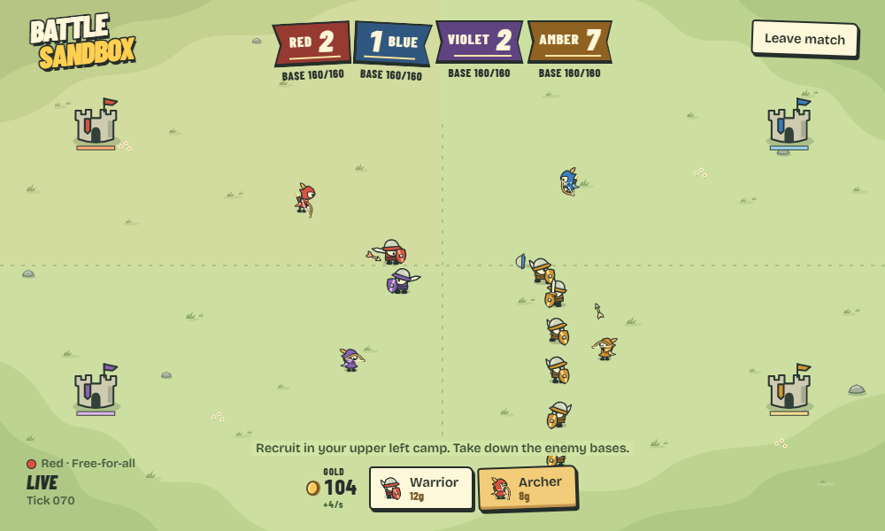

# Battle Sandbox

Draw a squad into a meadow and watch it fight. The home screen is a live playground. Open **Play modes** to challenge another player to a duel or bring three or four players into a free-for-all.



## Play locally

Use Node.js 22.18 or newer. Run these commands in the project directory.

```sh
npm ci
npm run play
```

The playground opens in your browser. To play together on the same network, have everyone open the **same Network URL** printed in the terminal and choose the same mode. Separate browsers or fresh tabs can also take different seats on one computer.

| Mode | Players | Where you can draw | Objective |
| --- | --- | --- | --- |
| Playground (`/`) | 1 | Anywhere, with any of four army colors | Experiment as long as you like |
| Duel (`/room`) | 2 | Red's left half or Blue's right half | Destroy the opposing base |
| Free-for-all (`/ffa`) | 3–4 | One fixed corner per player | Be the last player with a standing base |

### Playground

Click to place one troop. Hold and drag to add another every 24 arena units. Friendly troops breathe and blink while they wait. Place an enemy nearby and they react while your pointer is still down. Gold is unlimited. When a fight ends, you can paint the next one straight onto the same field. **Undo** removes the last stroke. **Clear** empties the field.

Watch a friendly Warrior standing between an Archer and its target. The Archer rises to follow its shot, and the Warrior ducks as the arrow reaches its shoulder. [Watch the character animation](media/over-the-shoulder.mp4)

### Multiplayer

1. **Deploy.** Each commander starts with **120 gold** and a **160 HP base**. Draw an opening army inside your territory. A drag previews its total cost and commits the whole squad when released. **Undo** and **Clear** refund your own opening purchases.
2. **Ready up.** Once each player has a troop and everyone presses **Ready**, the field counts down **3, 2, 1**. Remaining gold carries into battle. A fourth free-for-all player can join before the countdown begins.
3. **Reinforce.** Collect **4 gold per second** while your base stands. Draw reinforcements in your territory during the fight. The first troop appears on press and the others join as your brush travels. Defeating a troop pays its bounty on the tick it falls.
4. **Take the bases.** Troops advance on the nearest living enemy troop or base. Even an empty army can rebuild while its base stands. When a base falls, its remaining troops retreat from play. The last base standing wins. If all remaining bases fall on the same tick, the match is a draw. **New round** restores every occupied base and starting purse.

| Troop | Recruit | Bounty | HP | Damage | Reach | Time between attacks |
| --- | ---: | ---: | ---: | ---: | ---: | ---: |
| Warrior | 12 gold | 6 gold | 30 | 10 | 48 | 0.5 s |
| Archer | 8 gold | 4 gold | 20 | 8 | 120 | 0.8 s |

A free-for-all pays one bounty per defeated troop. If more than one army deals damage on the fatal tick, the largest contribution earns the reward. Ties use the fixed seat order of Red, Blue, Violet, then Amber. Troops removed when their base falls pay no bounty.

### Reconnecting

A connection loss reserves your seat for 60 seconds. Reopen the match to reclaim your color, gold and current view of the battle. The server keeps running while you are away. Accepted placement commands have IDs scoped to the player and round, so a retry returns the original troop IDs and charges once. **Leave match** releases the seat immediately. A departure before battle unlocks the other players' formations. During battle, a departed army fights on while another player remains.

## Run the checks

| Command | What it demonstrates |
| --- | --- |
| `npm test` | Fixed-tick combat, brush spacing, gold, bounties, bases, and two real WebSocket clients |
| `npm run check:modes` | Live solo placement and complete three- and four-player matches in differently sized browsers, including live purchases, reconnection and rematches |
| `npm run demo:room -- --headed` | Two browser windows drawing at the same time, then recruiting during a base battle |
| `npm run demo:retry` | Drop confirmation of a five-Warrior stroke, disconnect and return with the original five IDs and one charge |
| `npm run demo:reconnect` | Disconnect Blue after the first hit, catch up to the live fight and verify both browsers agree through the fall of a base |

Browser checks use Playwright Chromium when available or installed Chrome. Use `npx playwright install chromium` to install the test browser. The two disconnect demos leave their result windows open until you close one. Add `-- --headless` for unattended use or `-- --output <directory>` to save both views and the comparison.

## How the field works

The browser playground and Node match server share a deterministic 60-tick simulation. Targets break distance ties by stable ID. Warriors and Archers have circular footprints, separate when crowded and stay inside the arena. Arrows fly at 300 arena units per second, starting on the tick after release. They pass allies and strike the first living enemy troop or base along their line. All impacts on a tick resolve together. A Warrior duel beginning in reach deals simultaneous hits on ticks 1, 31 and 61. [Combat simulation](src/simulation.ts) · [Troop definitions](src/units.ts)

The server validates territory and funds, assigns IDs and broadcasts the same world to every browser. It normally sends 20 snapshots per second, with additional updates for purchases, payouts and changes of phase. Each browser projects the same 960 × 360 arena onto its own canvas.

For a local development server on loopback, use `npm run dev`. To serve the production build, run `npm run build` and `npm start`. The Node server defaults to `127.0.0.1:4173` and accepts `HOST` and `PORT`.
