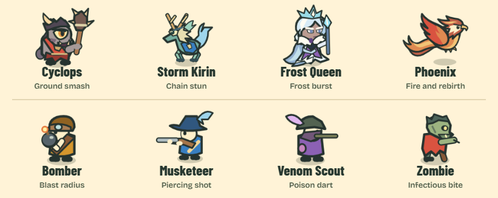

# Battle Sandbox

Draw a squad into a meadow and watch it fight. The illustrated row along the bottom holds twenty-five troops and buildings and six spells. The home screen is a live playground. Open **Play modes** for a two-player duel or a three- or four-player free-for-all.


## Play locally

Use Node.js 22.18 or newer. Run these commands in the project directory.

```sh
npm ci
npm run play
```

The playground opens in your browser. To play together on the same network, have everyone open the **same Network URL** printed in the terminal and choose the same mode. Separate browsers or fresh tabs can also take different seats on one computer.

| Mode | Players | Where you can draw | Objective |
| --- | --- | --- | --- |
| Playground (`/`) | 1 | Anywhere, with any of four army colors | Experiment as long as you like |
| Duel (`/room`) | 2 | Your half, or anywhere for a Miner | Destroy the opposing base |
| Free-for-all (`/ffa`) | 3–4 | Your corner, or anywhere for a Miner | Be the last player with a standing base |

Pick **People**, **Machines**, **Towers**, **Mythical** or **Spells**, then tap a portrait to arm it. Swipe the row sideways, roll the mouse wheel over it, or use its arrows. Browsing keeps the current brush armed until you pick another portrait. The category and brush are remembered when you reload. Number keys **1–9** select the first nine portraits in the open category, and **0** selects the tenth. In matches, spells unlock when the countdown ends.

An Archer's bowstring sounds at release. The hit sounds when the arrow reaches its target. A Meteor whistles on the way down and lands with a low thump. Press **M** or use the speaker button to mute or unmute. [Watch two Meteor strikes and a mid-fight troop switch with sound](media/field-palette.mp4)

### Playground

Click to place one troop. Hold and drag to add another every 24 arena units. Friendly troops breathe and blink while they wait. Place an enemy nearby and they react while your pointer is still down. Gold is unlimited. When a fight ends, you can paint the next one straight onto the same field. **Undo** removes the last stroke. **Clear** empties the field.

Run `npm run demo:siege` to watch a Watchpost hit itself with three reflected bolts, two Lancers get caught under a falling stone, rain interrupt a Sun Lens, and a tremor dig a Miner out early. It leaves three Blue towers on the field with Red's Fault Line selected. Aim between two towers to crack both. With the game already running, open `/?demo=siege` to go straight to that lineup. [Watch the four encounters with sound](media/siege-and-spells.mp4)

Let a Lancer build speed toward a distant Watchpost. Place a Storm Kirin beside the approaching line. Follow the bolt along the enemy formation and watch the spear lift when the stun erases its charge. [Watch the battle clip](media/mythical-encounters.mp4)

This command plays the chain strike, the Cyclops's ground smash, a Frost Queen fight under Healing Rain, and the Phoenix's rebirth. It then leaves the field open for you.

```sh
npm run demo:encounters
```

A friendly Warrior standing between an Archer and its target ducks as the arrow passes its shoulder. The Archer rises to follow the shot. [Watch the Archer and Warrior](media/over-the-shoulder.mp4)

Run `npm run demo:motion` to watch the Phoenix glide, strike with its talons and climb away. Three more encounters show a Lancer charging a Cyclops, a Musketeer reloading as a Reaper closes, and a Storm Kirin rearing under the Frost Queen's staff. The demo then leaves eight blue troops on the field. Place the selected Red Shieldbearer near the Phoenix for a talon strike, or beside the Cyclops to see it lift its club. A troop flashes white for seven ticks when damage lands, including each pulse of poison or fire. [Watch the same fights before and after](media/troops-in-motion.mp4)

Place a Zombie beside an enemy Archer. The Archer turns at the first bite, keeps its feathered cap and can infect the next human it reaches. [See the same Archer before and after the bite](media/zombie-bite.png)

### Multiplayer

1. **Deploy.** Each commander starts with **120 gold** and a **160 HP base**. Draw an opening army inside your territory. A Miner can take a tunnel to any point on the field, even behind another base. The little flag marks where it will surface after the countdown. A drag previews its total cost and commits the whole squad when released. **Undo** and **Clear** refund your own opening purchases.
2. **Ready up.** Once each player has a troop and everyone presses **Ready**, the field counts down **3, 2, 1**. Remaining gold carries into battle. A fourth free-for-all player can join before the countdown begins.
3. **Reinforce.** Collect **4 gold per second** while your base stands. Draw reinforcements in your territory during the fight, or send a Miner outside it. The first troop appears on press and the others join as your brush travels. Tap to cast spells anywhere on the field, including in an opponent's camp. Defeating a troop pays its bounty on the tick it falls.
4. **Take the bases.** The lookout on each base tracks a hostile troop within 160 arena units. It takes 0.3 seconds to aim, then fires a 6-damage bolt up to once every 1.2 seconds. A Shieldbearer in the firing line can absorb most of the hit. Even an empty army can rebuild while its base stands. When a base falls, its remaining troops retreat from play. The last base standing wins. If all remaining bases fall on the same tick, the match is a draw. **New round** restores every occupied base and starting purse.

A free-for-all pays one bounty per defeated troop. If more than one army deals damage on the fatal tick, the largest contribution earns the reward. Ties use the fixed seat order of Red, Blue, Violet, then Amber. Troops removed when their base falls pay no bounty.

### The roster



The Kirin folds its front legs as lightning fires. The Cyclops lifts its club above its eye before a smash. [Watch eight troops idle and meet an enemy before and after the redraw](media/roster-redraw.mp4)

| Troop or building | Gold | Bounty | What to watch |
| --- | ---: | ---: | --- |
| Warrior | 12 | 6 | Hurries into sword range and ducks under a friendly arrow. |
| Archer | 8 | 4 | Stops at bow range and peeks over a friendly shield or sword when shooting. |
| Shieldbearer | 16 | 8 | Lifts the shield when a shot approaches. Stops a piercing bullet and takes one quarter of direct frontal shot damage, rounded up. A ground blast can reach behind the shield. |
| Field Medic | 10 | 5 | Crouches and unrolls a bandage toward a wounded ally. Finishing a wrap removes poison. A hit interrupts treatment. |
| Lancer | 14 | 7 | Lowers the lance after a straight run. Facing shields check the thrust. Any stun erases the run-up, including a stun on the contact tick. |
| Bomber | 16 | 8 | Lobs a sparking bomb at a fixed spot. When it lands it deals 13 damage to each enemy troop within 43 arena units. |
| Musketeer | 17 | 8 | One bullet deals 11 damage to its first enemy and 6 to the next. A front-facing shield or a base ends the shot. |
| Venom Scout | 13 | 6 | The dart deals 3 immediately, then venom deals 3 every half second for three pulses. Machines and Zombies resist venom. |
| Miner | 19 | 9 | Plant an exit flag anywhere. A traveling dirt ridge starts at home. Fault Line can force it to surface early. Once above ground the Miner can be hit and swings its pick after a short emergence. |
| Clown | 18 | 9 | Tosses a striped balloon that leaves a poison cloud for 1.35 seconds. Late arrivals can inhale the poison. Enemy Gust clears the cloud, and a Medic can treat the poison. |
| Engineer | 21 | 10 | Hammers together one Watchpost near the fight, then repairs damaged machines. |
| Clockmouse | 8 | 4 | A squeak at a Cyclops's boots can interrupt a raised club, even on its own team. |
| Bolt Drone | 15 | 7 | Commits to one line for a three-bolt burst. A sidestepping enemy can escape the later shots. |
| Mouse Workshop | 23 | 11 | Winds the drum and releases up to three Clockmice, one at a time. |
| Watchpost | 15 | 7 | Stays where it was built and fires at enemies in range. An Engineer can mend it. |
| Stone Lobber | 24 | 12 | Marks the ground, then slings a boulder there. Up to 35 units from impact, ground enemies take 16 damage and bases take 8. Flyers and troops closer than 65 units to the sling evade its aim. |
| Sun Lens | 27 | 13 | Keeps its beam on one enemy. Successive stages pulse for 3, 6 and 10 damage as the facets light. Breaking range, a stun or an enemy rain shower resets the focus. |
| Bell Tower | 19 | 9 | Tolls when a ground troop comes within 65 units. Ground troops in the circle take 4 damage and are shoved and briefly stunned. A charging Lancer has to start its run again. |
| Cyclops | 33 | 16 | Raises its spiked club for 0.45 seconds, then smashes a patch of ground. The impact scatters enemies and stuns them. It can lift and swallow a human at 12 HP or less who stays within reach. |
| Storm Kirin | 23 | 11 | Lightning travels through up to four enemies, stunning every contact for 0.35 seconds. Metal and shields carry the next jump up to 110 units. Other targets carry it up to 78. |
| Frost Queen | 24 | 12 | Her crystal bursts on impact. Enemies inside the frost walk at 48% speed for 100 ticks. |
| Phoenix | 22 | 11 | A talon strike sets its target on fire for three pulses of 2 damage. On its first defeat it becomes a 1 HP ember egg and hatches at half health after 1.5 seconds if protected. |
| Zombie | 10 | 5 | One bite immediately turns a surviving human green and changes its team. Look for the former troop's headgear. The new Zombie keeps its ID and up to 33 remaining HP, then can spread the bite. |
| Reaper | 25 | 12 | Its scythe seeks a living enemy at or below one-third health within 118 units, even if a healthy foe is nearer. Cutting down a living enemy draws one soul into its lantern and restores up to 8 HP. |
| Witch | 29 | 14 | The pink spiral turns an enemy person or creature into a Hex Pig on impact. It fights its old allies for three seconds. Survivors change back with the same ID and remaining health. Bases and machines take a direct magic hit. |

| Spell | Gold | What happens |
| --- | ---: | --- |
| Gust | 10 | Shoves enemies and scatters hostile arrows and bolts in its circle. Bullets and lobbed bombs keep flying. A friendly Phoenix egg hatches immediately. |
| Meteor | 20 | A white-hot stone sheds flame and cinders from the top edge. It strikes the marked ground after 0.8 seconds, dealing 17 damage to enemies still inside or 6 to a base. |
| Healing Rain | 15 | Crosses in the caster's color rise with each of three healing pulses. Each gives friendly people and creatures up to 5 HP, extinguishes burning allies, puts out enemy Phoenix eggs and fogs enemy Sun Lenses. |
| Fault Line | 18 | Two tremors each deal 12 damage to enemy buildings, 3 to ground troops and 3 to bases. An underground Miner caught by either pulse surfaces right there. |
| Briar Snare | 13 | At the moment the vines spring up, they catch grounded enemies for 1.3 seconds. Rooted troops can still shoot or strike within reach. A Phoenix hit burns the vines away. |
| Mirror Ward | 14 | Three circling panes intercept enemy arrows and bolts as they enter. Each shot turns back along its path and can hit its shooter. Bullets, boulders and magic pass through. The ward lasts three seconds. |

Stars overhead mark a stun. Ice around the feet marks a slow. Violet bubbles mean poison. Green skin and a torn coat show that a human has already become a Zombie. Small orange flames on an enemy mean it is taking burn damage. The Phoenix's cracked ember egg counts down to its own rebirth. A Phoenix in flight sheds sparks and a passing Frost Queen leaves small ice crystals. These trails follow their actual movement and fade when they stop.

### Reconnecting

A connection loss reserves your seat for 60 seconds. Reopen the match to reclaim your color, gold and current view of the battle. The server keeps running while you are away. Accepted purchases have IDs scoped to the player and round. Retrying a stroke or spell returns the original IDs and charges once. **Leave match** releases the seat immediately. A departure before battle unlocks the other players' formations. During battle, a departed army fights on while another player remains.

## Run the checks

| Command | What it demonstrates |
| --- | --- |
| `npm test` | Fixed-tick combat, troop interactions, towers, spells, returning to a full-roster fight, brush spacing, spending and two real WebSocket clients |
| `npm run demo:encounters` | A charged Lancer meets chain lightning, a Cyclops smashes and swallows, and a Phoenix hatches from its ember egg. |
| `npm run demo:siege` | Four short tower and spell encounters, followed by a live field for trying a cast. |
| `npm run demo:oddities` | See the new troops in six short fights, then try turning an Archer in the live playground. [Watch the gameplay clip](media/tunnels-and-turncoats.mp4) |
| `npm run check:modes` | All 31 portraits, touch scrolling, sound, a cross-field Meteor, desktop and phone reconnects after a chain stun or reflected Watchpost bolt, and complete three- and four-player matches with rematches |
| `npm run demo:room -- --headed` | Two browser windows drawing at the same time, then recruiting during a base battle |
| `npm run demo:retry` | Drop confirmation of a five-Warrior stroke, disconnect and return with the original five IDs and one charge |
| `npm run demo:reconnect` | Disconnect Blue after the first hit, catch up to the live fight and verify both browsers agree through the fall of a base |

Browser checks use Playwright Chromium when available or installed Chrome. Use `npx playwright install chromium` to install the test browser. The two disconnect demos leave their result windows open until you close one. Add `-- --headless` for unattended use or `-- --output <directory>` to save both views and the comparison.

## How the field works

The browser playground and Node match server share a deterministic 60-tick simulation. Targets break distance ties by stable ID. Troops have circular footprints, separate when crowded and stay inside the arena. Buildings stay rooted. Arrows fly at 300 arena units per second, starting on the tick after release. They pass allies and strike the first living enemy troop or base along their line. Damage on a tick resolves together. Instant lightning and completed ground smashes interrupt wind-ups before charged attacks land. A Warrior duel beginning in reach deals simultaneous hits on ticks 1, 31, 61 and 91. Both 40 HP Warriors fall on the fourth hit. [Combat simulation](src/simulation.ts) · [Troop definitions](src/units.ts)

The server validates territory and funds, assigns IDs and broadcasts the same world to every browser. It normally sends 20 snapshots per second, with additional updates for purchases, payouts and changes of phase. Each browser projects the same 960 × 360 arena onto its own canvas.

For a local development server on loopback, use `npm run dev`. To serve the production build, run `npm run build` and `npm start`. The Node server defaults to `127.0.0.1:4173` and accepts `HOST` and `PORT`.
